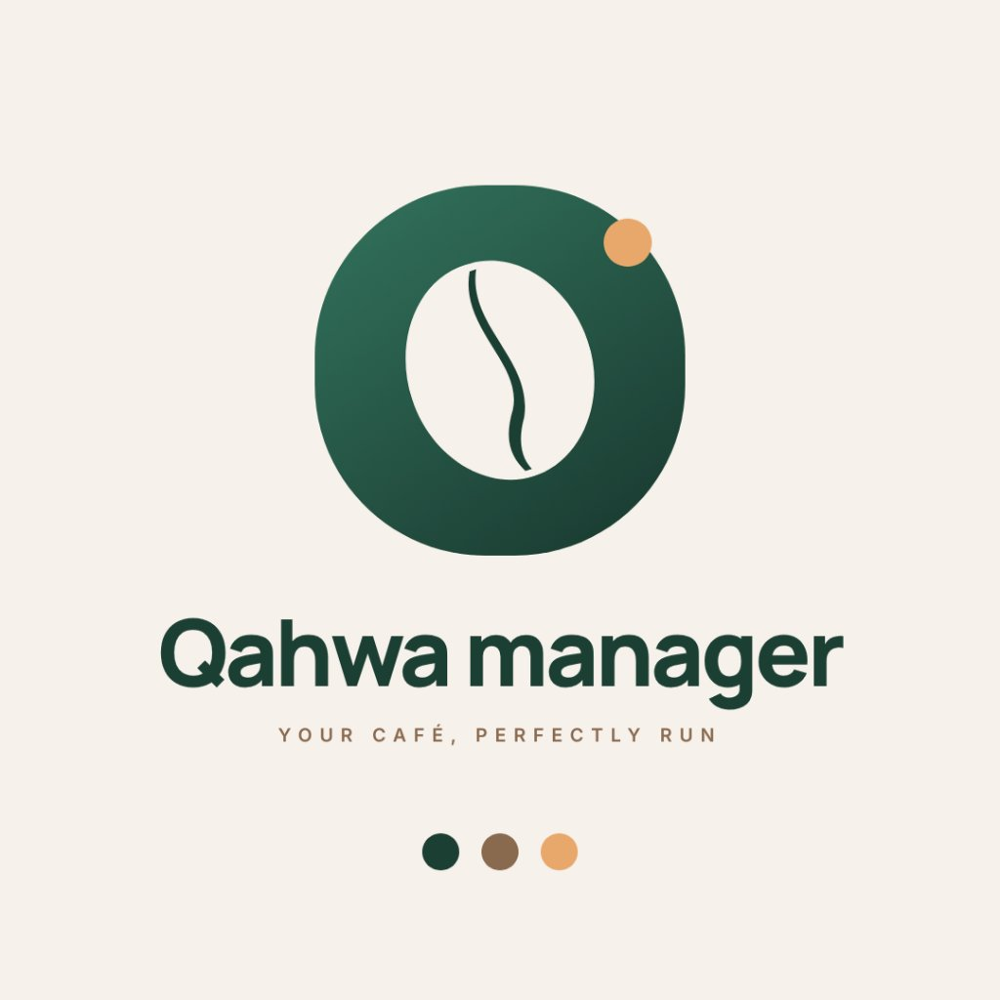
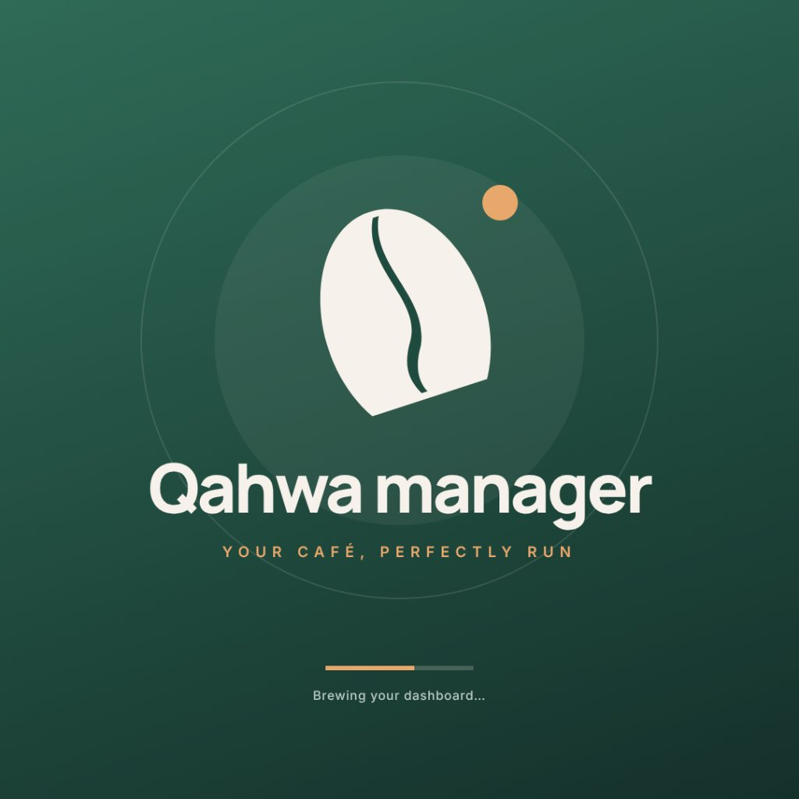

<div align="center">

# ☕ Qahwa manager — مدير القهوة
**YOUR CAFÉ, PERFECTLY RUN**

A modern, minimalist Android Point-of-Sale (POS) and café management application crafted for Moroccan coffee shops — built with **Kotlin**, **Jetpack Compose (Material 3)**, **Hilt**, and **Room**.

[](https://github.com/erratbaoui/qahwa-manager/releases/latest)
[-285944)](https://developer.android.com)
[](https://kotlinlang.org)
[](https://developer.android.com/jetpack/compose)
[-143023)](#trilingual-localization--native-rtl)

<p align="center">
  
  &nbsp;&nbsp;
  
</p>

</div>

---

## ✨ Overview

**Qahwa manager** is an offline-first, fast, and touch-friendly POS and operations app tailored for Moroccan cafés (*Qahwa*, *Atay*, pastries, and fresh juices). It combines a calm Scandinavian-inspired layout with warm Moroccan café aesthetics, exact integer-centime currency handling in **Moroccan Dirhams (MAD / درهم)**, and instant switching between **Light & Dark themes** and **Arabic (RTL), French, and English**.

### 📥 Download & Install
Grab the latest ready-to-install APK (`QahwaManager-<version>.apk`) from [**GitHub Releases (latest)**](https://github.com/erratbaoui/qahwa-manager/releases/latest). Every release is signed with the same key, so a new version installs over the old one and keeps your data.

> **Android says the app "conflicts with an existing package" or won't update?** Early builds (including `v1.0.0`) were signed with temporary keys. Uninstall the old app once, then install the latest release. This deletes the data on that device. Updates after that install normally.

---

## 🚀 Key Features & Screens

### 1. 🏠 Dashboard (`HomeScreen`)
- **Daily Activity Snapshot:** Instant view of **Today's Revenue (MAD)** and **Open Orders** count.
- **Low-Stock Alerts:** Automatic notification banner when any ingredient drops at or below its minimum threshold.
- **One-Tap Actions:** Quick-launch button to open a new POS order immediately, plus top-bar controls to switch **Light/Dark mode** and **Language**.

### 2. 🧾 Point of Sale & Order Management (`OrdersListScreen`, `NewOrderScreen`, `OrderDetailScreen`)
- **Fast Order Creation:**
  - Filter products by category (**All**, **Coffee / قهوة**, **Tea / شاي**, **Food / مأكولات**, **Juice / عصائر**).
  - Assign a **Table Number** or toggle **Takeaway (À emporter / وجبة خارجية)** mode.
  - Centered tabular-numeral quantity steppers (`−` / `+`) that never shift layout as digit counts change.
  - **Adaptive Layout:** Automatically switches between a compact docked-cart layout on phones and a **two-pane side-by-side POS layout** on tablets and wide screens ($\ge 720\text{dp}$).
- **Live Order Tracking & Checkout:**
  - View all open orders with timestamps and status badges (`Open`, `Paid`, `Cancelled`).
  - Inspect itemized order breakdowns with historical item name snapshots.
  - **Mark as Paid** or **Cancel Order** with confirmation dialogs.

### 3. ☕ Menu Management (`MenuScreen`)
- **Category Tabs:** Browse items across Coffee, Tea, Food, and Juice.
- **Trilingual Product Catalog:** Create and manage products with dedicated **English (`name`)**, **French (`nameFr`)**, and **Arabic (`nameAr`)** names, description, category, and price in MAD.
- **Instant Availability Toggle:** Enable or disable items on the POS menu with a single switch, or delete items with confirmation.

### 4. 📦 Inventory Management (`InventoryScreen`)
- **Ingredient Tracking:** Monitor stock levels across units (`kg`, `L`, `pcs`, `g`, `pack`) with pre-seeded Moroccan café staples (Coffee Beans, Milk, Mint, Sugar, Green Tea, Oranges, etc.).
- **Smart Stepper Controls:** Increment/decrement by `1` for discrete pieces (`pcs`) or `0.5` for weight/volume units (`kg`, `L`).
- **Low-Stock Highlighting:** Visual warning badges and threshold indicators when `quantity <= lowStockThreshold`.

### 5. 👥 Staff, Shifts & Cash Settlement (`ShiftCard`, `EndShiftScreen`, `ShiftsScreen`, `ShiftReportScreen`, `StaffScreen`)
- **One waiter per shift:** Every order belongs to the shift it was placed in and the shift that collected the money. The waiter taps their name to start a shift (no PIN), sees the cash collected so far on Home, and ends the shift from a screen that lists every open table with *Mark paid*.
- **Never blocked:** If the previous waiter went home without ending their shift, the next one taps *Take over*. The old shift is flagged "ended by takeover" and its open tables are recorded as left open.
- **Settlement:** The owner sees expected cash (orders paid during the shift), types the counted cash (`610,50` or `610.50`), and the difference (short/over/exact) is stored for good, with cancellations, tables left open and wrong-PIN attempts on the same report.
- **History per waiter:** Settled shifts, filterable by waiter, with the running total of differences.
- **Staff:** Add, rename, deactivate and reactivate waiters. Nobody is ever deleted, so history stays intact.

### 6. 🔐 Owner Mode
- **First launch** sets up the owner: a name, a 4-digit PIN, and a one-time **recovery code** to write down.
- **Owner-only actions** ask for the PIN when tapped: cancelling an order, editing the menu and prices, editing stock, viewing café revenue and sales, managing staff and settling shifts. Waiters can still toggle a menu item available/unavailable.
- **Owner mode** stays on for 2 minutes of inactivity, ends when the app goes to the background or when *Lock* is tapped, and is never persisted across restarts.
- **Wrong PIN:** 5 free tries, then a 1-minute lock that doubles each time (up to an hour) and survives the app being killed. Every failed attempt is counted on the active shift's report.
- **Forgot PIN:** the recovery code sets a new PIN and issues a new code.

### 7. 📊 Sales & Analytics (`SalesScreen`, owner only)
- **Time-Window Filters:** Filter paid orders by **Today**, **This Week**, or **All Time**.
- **Revenue Ledger:** Displays total revenue in MAD, total completed order count, and a chronological ledger of paid orders.

### Known limits
- Orders a waiter never types in can't be caught; a stock-vs-sales check is a later feature.
- Anyone holding the tablet can clear the app's data from Android settings, wiping the history. Backup is the next project.
- The tablet's clock is trusted for shift times and the PIN lockout.

---

## 🎨 Design System: Light & Dark Themes

Inspired by the brand identity, `QahwaManagerTheme` provides two dedicated palettes and a one-tap header toggle (`AppThemeManager`):

| Token Role | Light Mode (Warm Cream & Forest) | Dark Mode (Deep Emerald & Amber) |
|---|---|---|
| **Background** | `#F4EFEA` (Warm Linen Cream) | `#122A1E` (Deep Forest Night) |
| **Card Surface** | `#FFFFFF` (Pure White) | `#1A3A2B` (Elevated Emerald) |
| **Primary Accent** | `#1E4635` (Deep Forest Green) | `#E2A165` (Warm Amber Gold) |
| **Secondary Accent** | `#7D5D44` (Warm Coffee Brown) | `#D7B89E` (Soft Latte Beige) |
| **Main Text** | `#183528` (Forest Charcoal) | `#F4EFEA` (Warm Cream White) |
| **Secondary Text** | `#637069` (Muted Sage) | `#A6BEB3` (Soft Sage Mist) |
| **Divider / Border** | `#E0D7CC` | `#2B5340` |

---

## 🌍 Trilingual Localization & Native RTL

- **Supported Languages:**
  - 🇬🇧 **English** (`values/strings.xml`)
  - 🇲🇦 **Arabic — العربية** (`values-ar/strings.xml`) with **native Right-to-Left (RTL)** layout mirroring
  - 🇫🇷 **French — Français** (`values-fr/strings.xml`)
- **In-App Language Switcher:** Managed by `AppLocaleManager`, persisting the user's choice and dynamically updating `LocalLayoutDirection`, localized product names, plural rules, and locale-aware date/number formatting.
- **Automated Parity Verification:** `StringResourcesTest` enforces at build time that every string and plural in English has a matching translation and format placeholder in both Arabic and French.

---

## 🏗️ Architecture & Tech Stack

- **Language:** Kotlin 2.3 (JVM Toolchain 17)
- **UI Framework:** Jetpack Compose + Material 3 + custom `QahwaComponents` design system
- **Navigation:** AndroidX Navigation 3 (`NavDisplay`, `rememberNavBackStack`, per-entry `ViewModelStore` scoping)
- **Dependency Injection:** Dagger Hilt (`@HiltAndroidApp`, `@AndroidEntryPoint`, `@HiltViewModel`)
- **Persistence:** Room SQLite Database (`QahwaDatabase`, schema v3) with tested migrations, pre-populated with Moroccan café menu & inventory items, and exact integer centimes (`priceCentimes`, `totalCentimes`) to prevent floating-point rounding drift
- **Owner PIN:** salted PBKDF2 hashes only (`PinHasher`), in-memory `OwnerSession`, and an `OwnerGate` that asks for the PIN at the moment an owner-only action fires
- **Concurrency & State:** Kotlin Coroutines + `StateFlow` + `collectAsStateWithLifecycle()`

```text
app/src/main/kotlin/com/example/qahwamanager/
├── data/
│   ├── db/            # Room Database, DAOs, TypeConverters, and SQL Migrations
│   ├── model/         # Entities: MenuItem, Order, OrderItem, InventoryItem
│   ├── repository/    # MenuRepository, OrderRepository, InventoryRepository, SalesRepository
│   └── time/          # Day & week boundary calculators for sales analytics
├── di/                # Hilt AppModule bindings
├── ui/
│   ├── common/        # QahwaComponents, AppLocaleManager, AppThemeManager, formatters
│   ├── home/          # Dashboard Screen & ViewModel
│   ├── orders/        # POS NewOrderScreen, OrdersListScreen, OrderDetailScreen & ViewModel
│   ├── menu/          # MenuScreen & ViewModel
│   ├── inventory/     # InventoryScreen & ViewModel
│   ├── sales/         # SalesScreen & ViewModel
│   ├── splash/        # Animated brand SplashScreen
│   └── theme/         # Color, Theme (Light & Dark), and Typography
├── util/              # Centime math, decimal parsing, localized item naming
├── MainActivity.kt
├── Navigation.kt
└── NavigationKeys.kt
```

---

## 🛠️ Building & Running Locally

### Prerequisites
- **JDK 17** (e.g. OpenJDK 17)
- **Android SDK** (compileSdk 37, minSdk 24)

### Build Commands
```bash
# 1. Clone the repository
git clone https://github.com/erratbaoui/qahwa-manager.git
cd qahwa-manager

# 2. Run unit & localization parity tests
./gradlew test

# 3. Build the installable Debug APK
./gradlew assembleDebug
```

---

## 📄 License

This project is open-source and available under the MIT License.
